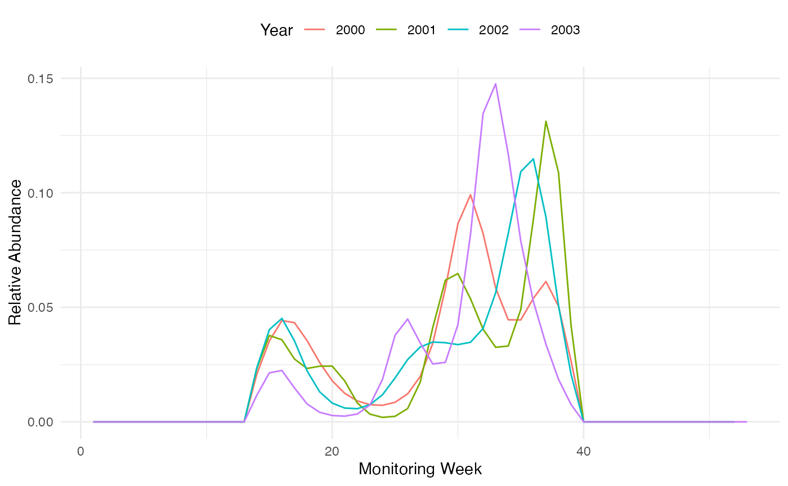
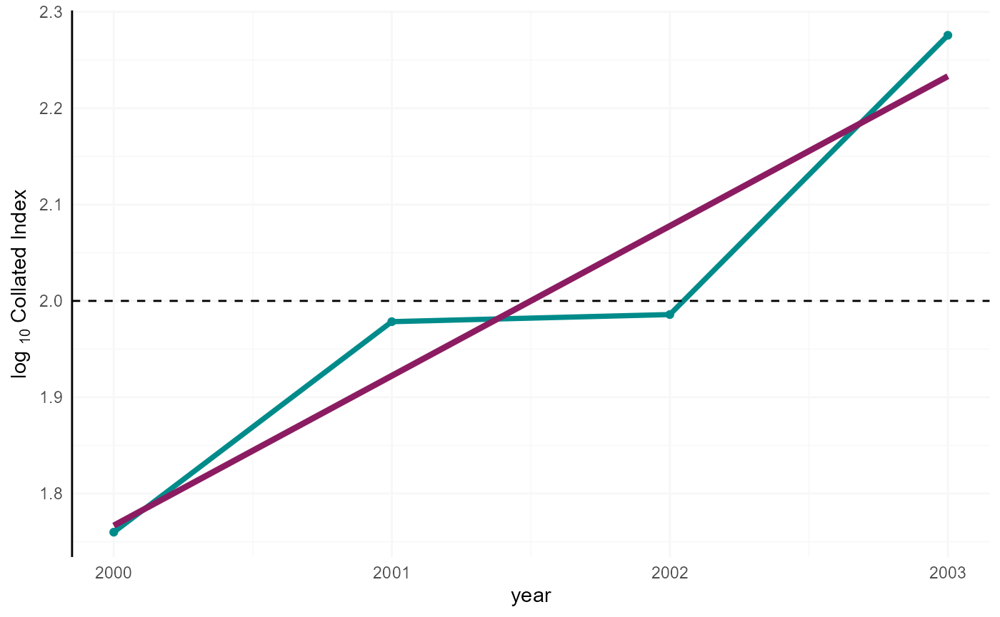

# Calculating phenology and collated indices with rbms

The `rbms` package allows users to derive species phenology and estimate
abundances of butterfly species. In this tutorial, we use R functions
implemented in the `rbms` package to produce the following key outputs:

1.  **Compute a flight curve**: A spline fitted curve, representing the
    activity of the species within the monitoring season. The flight
    curve computation is based on a spline fitted on the counts
    collected across multiple sites and standardised to sum to 1 (area
    under the curve is one).
2.  **Site indices and annual collated indices**: The yearly abundance
    at each site, and a model estimate of yearly abundance across all
    sites.

Pre-requisite steps include the construction of a time series and
imputation of counts from the flight curve when abundance data is
missing.

The data used in this vignette are bundled within the package and are
from genuine Butterfly Monitoring Scheme surveys.

## 1. Setup

First, install and load required packages.

\
`# Install required packages`\
[`install.packages`](https://rdrr.io/r/utils/install.packages.html)`(``"remotes"``)`` ``# To install R packages from github`\
[`install.packages`](https://rdrr.io/r/utils/install.packages.html)`(``"ggplot2"``)`` ``# to generate plots in this tutorial`\
\
`# Install rbms from github`\
`remotes``::`[`install_github`](https://remotes.r-lib.org/reference/install_github.html)`(``"RetoSchmucki/rbms"``)`

\
`# Load rbms and ggplot2`\
[`library`](https://rdrr.io/r/base/library.html)`(`[`rbms`](https://retoschmucki.github.io/rbms/)`)`

    ##  Welcome to rbms, version 1.3.1 
    ##  This package has been tested, but is still in active development and feedbacks are welcome
    ##  https://github.com/RetoSchmucki/rbms/issues

\
[`library`](https://rdrr.io/r/base/library.html)`(`[`ggplot2`](https://ggplot2.tidyverse.org)`)`

Then load the bundled butterfly monitoring scheme data bundled with the
rbms package.

\
[`data`](https://rdrr.io/r/utils/data.html)`(``m_visit``)`\
[`data`](https://rdrr.io/r/utils/data.html)`(``m_count``)`

**The header names of the visit and count data need to be consistent,
and all columns present in the data loaded for this tutorial need to be
present in your data for the functions to work.**

Visit data represents the date at which each monitoring site was
visited. If no butterfly was observed during a visit, the abundance for
that specific visit would be set to zero. This allows to subset positive
non-zero counts from the count data set, which result in smaller objects
to handle. The visit data may contain many columns, but only two are
essential for the function.

*NOTE: Visit and count data are provided in data.table format, and
likewise data.table syntax is used for many of the data processing steps
in this tutorial. Whilst other formats and packages are acceptable, it
is recommended for larger datasets that you continue to use data.table,
as it is efficient for handling large data sets*

1.  **SITE_ID** (can be numbers of characters and treated as a
    non-numeric factor)
2.  **DATE** (by default, the format is “%Y-%m-%d” (e.g., 2019-11-28\]).
    If a different format needs to be specified, use the argument
    DateFormat)

&nbsp;

    ##        SITE_ID       DATE
    ##          <int>     <char>
    ##     1:       1 2000-04-07
    ##     2:       1 2000-04-19
    ##     3:       1 2000-05-12
    ##     4:       1 2000-05-15
    ##     5:       1 2000-05-24
    ##    ---                   
    ## 12136:     193 2004-08-19
    ## 12137:     193 2004-08-31
    ## 12138:     193 2004-09-04
    ## 12139:     193 2004-09-15
    ## 12140:     193 2004-09-28

Count data must be provided in columns with specific headers; more
column can be provided, but rbms only use the following four:

1.  **SITE_ID**
2.  **DATE**
3.  **SPECIES**
4.  **COUNT**

&nbsp;

    ##       SITE_ID       DATE SPECIES   DAY MONTH  YEAR COUNT
    ##         <int>     <char>   <int> <int> <int> <int> <int>
    ##    1:       1 2000-04-07       2     7     4  2000     5
    ##    2:       1 2000-04-19       2    19     4  2000     3
    ##    3:       1 2000-05-12       2    12     5  2000     1
    ##    4:       1 2000-05-12       4    12     5  2000     2
    ##    5:       1 2000-05-15       4    15     5  2000     4
    ##   ---                                                   
    ## 5303:     193 2003-09-06       2     6     9  2003     1
    ## 5304:     193 2004-04-23       2    23     4  2004     2
    ## 5305:     193 2004-05-02       2     2     5  2004     1
    ## 5306:     193 2004-06-19       2    19     6  2004     2
    ## 5307:     193 2004-07-10       2    10     7  2004     1

##### **2.** organise the data to cover the time period and monitoring season of the BMS

Using the visit and count data, we need to create a new data.table
object representing a time series. We initialise the time-series,
specifying the start and end year of the monitoring season, with entries
at a weekly or daily basis (the resolution of the flight curve). In a
first step, we initialise the time-series with an initial year with the
InitYear argument, and end year with the LastYear argument. We also
specify the first day of the week with the WeekDay1 argument as either
‘sunday’ or ‘monday’.

**2.1.** First, we initialise a time-series with day-week-month-year
information.

\
`ts_date`` ``<-`` ``rbms``::`[`ts_dwmy_table`](https://retoschmucki.github.io/rbms/reference/ts_dwmy_table.md)`(``InitYear ``=`` ``2000``, LastYear ``=`` ``2003``, WeekDay1 ``=`` ``'monday'``)`

**2.2.** Add the monitoring season to the time-series

We build upon the time series with the monitoring season, providing the
StartMonth and EndMonth arguments. The definition of the monitoring
season can be refined with more arguments of the start and end date
(StartDay, EndDay). We also define the resolution of the time-series as
weekly using the Timeunit argument (`w` or `d` for weekly or daily
records). The ANCHOR argument adds zeros before and after the monitoring
season, to ensure that the flight curve starts and ends at zero.

*NOTE: For species with overwintering adult and early counts, having an
Anchor set to zero might sound wrong, and we are currently working on
finding an alternative for these cases to represent the flight curve of
those species better.*

\
`ts_season`` ``<-`` ``rbms``::`[`ts_monit_season`](https://retoschmucki.github.io/rbms/reference/ts_monit_season.md)`(``ts_date``, StartMonth ``=`` ``4``, EndMonth ``=`` ``9``, StartDay ``=`` ``1``, EndDay ``=`` ``NULL``, CompltSeason ``=`` ``TRUE``, Anchor ``=`` ``TRUE``, AnchorLength ``=`` ``2``, AnchorLag ``=`` ``2``, TimeUnit ``=`` ``'w'``)`

**2.3.** Add site visits to the time-series

Now that the monitoring season has been defined, we use the
[`ts_monit_site()`](https://retoschmucki.github.io/rbms/reference/ts_monit_site.md)
function to integrate the time-series with the site visits. We use the
visit data and link it with the time series contained in ts_season
object.

\
`ts_season_visit`` ``<-`` ``rbms``::`[`ts_monit_site`](https://retoschmucki.github.io/rbms/reference/ts_monit_site.md)`(``ts_season``, ``m_visit``)`

**2.4.** Add observed count

The time-series is next integrated with the count data. Here we must
specify the focus species in the sp argument, providing either an
integer (we have used 2 here), or a string.

\
`ts_season_count`` ``<-`` ``rbms``::`[`ts_monit_count_site`](https://retoschmucki.github.io/rbms/reference/ts_monit_count_site.md)`(``ts_season_visit``, ``m_count``, sp ``=`` ``2``)`

The resulting `data.table` object contains zeros and positive counts
recorded along each BMS transects for species 2, over the entire
time-series, but only within the focal monitoring season. When the
counts are missing because the site was not visited, the count is
informed as NA.

    ## Key: <DATE, SITE_ID>
    ## Index: <ANCHOR__M_SEASON>
    ##         M_YEAR       DATE DAY_SINCE  YEAR MONTH   DAY  WEEK WEEK_SINCE WEEK_DAY
    ##         <fctr>     <IDat>     <int> <int> <int> <int> <int>      <num>    <num>
    ##      1:   2000 2000-01-01         1  2000     1     1    52          1        6
    ##      2:   2000 2000-01-01         1  2000     1     1    52          1        6
    ##      3:   2000 2000-01-01         1  2000     1     1    52          1        6
    ##      4:   2000 2000-01-01         1  2000     1     1    52          1        6
    ##      5:   2000 2000-01-01         1  2000     1     1    52          1        6
    ##     ---                                                                        
    ## 173496:   2003 2003-12-31      1461  2003    12    31     1        210        3
    ## 173497:   2003 2003-12-31      1461  2003    12    31     1        210        3
    ## 173498:   2003 2003-12-31      1461  2003    12    31     1        210        3
    ## 173499:   2003 2003-12-31      1461  2003    12    31     1        210        3
    ## 173500:   2003 2003-12-31      1461  2003    12    31     1        210        3
    ##         M_SEASON COMPLT_SEASON ANCHOR COUNT SITE_ID SPECIES
    ##            <num>         <int>  <int> <int>   <int>   <num>
    ##      1:        0             1      0    NA       1       2
    ##      2:        0             1      0    NA       2       2
    ##      3:        0             1      0    NA       3       2
    ##      4:        0             1      0    NA       4       2
    ##      5:        0             1      0    NA       6       2
    ##     ---                                                    
    ## 173496:        0             1      0    NA     184       2
    ## 173497:        0             1      0    NA     185       2
    ## 173498:        0             1      0    NA     186       2
    ## 173499:        0             1      0    NA     187       2
    ## 173500:        0             1      0    NA     193       2

##### **3.** Compute the yearly flight curve for the data

With the time season data prepared and saved under ts_season_count, can
compute the flight curve, representing the species phenology.

we can compute the flight curve for each year by using the
`flight_curve` function. First we want to impose some minimal threshold
to control the quality of the data used to inform this model. This is
done by setting the Minimum number of visits (MinNbrVisit), the minimum
number of occurrences (MinOccur) and the number of sites (MinNbrSite) to
use to fit the model. These values can influence the model, and its
sensitivity will depend on the species and the dataset. Still, as a
minimum requirement, MinOccur should be set \>= 2, the MinNbrVisit \>
MinOccur and MinNbrSite \>= 5. These thresholds affect the data that
inform your model and the resulting flight curve. When higher values are
chosen, fewer sites will be available and if insufficient, the
thresholds need to be revised.

*NOTE: The `flight_curve` function assumes that species phenology is the
same across sites. The sample size of the data must be large enough to
calculate the flight_curve*

*You will also have to define some parameters for the distribution for
the GAM model as well as the maximum number of times to try to fit the
model and the number of samples to use. The later will take a random
sample from the data set if it contains more sites than the number
specified.*

\
` ``ts_flight_curve`` ``<-`` ``rbms``::`[`flight_curve`](https://retoschmucki.github.io/rbms/reference/flight_curve.md)`(``ts_season_count``, NbrSample ``=`` ``300``, MinVisit ``=`` ``5``, MinOccur ``=`` ``3``, MinNbrSite ``=`` ``5``, MaxTrial ``=`` ``4``, GamFamily ``=`` ``'nb'``, SpeedGam ``=`` ``FALSE``, CompltSeason ``=`` ``TRUE``, SelectYear ``=`` ``NULL``, TimeUnit ``=`` ``'w'``)`

We are given a list of 3 elements as an output of the
[`flight_curve()`](https://retoschmucki.github.io/rbms/reference/flight_curve.md)
function:

- pheno: The standardised phenology curve derived by fitting a GAM
  model, with a cubic spline to the count data;
- model: The result of the fitted GAM model;
- data: The data used to fit the GAM model.

We can now extract the pheno object, a data.frame that contains the
shape of the annual flight curves, standardised to sum to 1. The
flight-curves contained in the pheno object can be visualised with the
following line of codes.

\
`## Extract the phenology output`\
`pheno`` ``<-`` ``ts_flight_curve``$``pheno`\
\
`# Determine if 'trimWEEKNO' exists and set the appropriate x-axis variable`\
`x_var`` ``<-`` ``if``(``"trimWEEKNO"`` `[`%in%`](https://rdrr.io/r/base/match.html)` `[`names`](https://rdrr.io/r/base/names.html)`(``pheno``)``)``{``"trimWEEKNO"``}`` ``else`` ``{``"trimDAYNO"``}`\
\
`# Create the ggplot`\
[`ggplot`](https://ggplot2.tidyverse.org/reference/ggplot.html)`(``pheno``, `[`aes`](https://ggplot2.tidyverse.org/reference/aes.html)`(``x ``=`` ``.data``[[``x_var``]``]``, y ``=`` ``NM``, color ``=`` `[`factor`](https://rdrr.io/r/base/factor.html)`(``M_YEAR``)``)``)`` ``+`\
`  `[`geom_line`](https://ggplot2.tidyverse.org/reference/geom_path.html)`(``)`` ``+`\
`  `[`scale_color_discrete`](https://ggplot2.tidyverse.org/reference/scale_colour_discrete.html)`(``name ``=`` ``"Year"``)`` ``+`\
`  `[`labs`](https://ggplot2.tidyverse.org/reference/labs.html)`(``x ``=`` `[`ifelse`](https://rdrr.io/r/base/ifelse.html)`(``x_var`` ``==`` ``"trimWEEKNO"``, ``"Monitoring Week"``, ``"Monitoring Day"``)``,`\
`       y ``=`` ``"Relative Abundance"``)`` ``+`\
`  `[`theme_minimal`](https://ggplot2.tidyverse.org/reference/ggtheme.html)`(``)`` ``+`\
`  `[`theme`](https://ggplot2.tidyverse.org/reference/theme.html)`(``legend.position ``=`` ``"top"``)`

Flight curve.

##### **4.** Impute predicted counts for missing monitoring dates

From the flight curve and the observed counts, we can derive expected
values for weeks or days where a site has not been monitored. Together,
observed and imputed counts are used to compute abundance indices across
sites. Site indices are then used to calculate annual collated indices.

The
[`impute_count()`](https://retoschmucki.github.io/rbms/reference/impute_count.md)
function uses the time season data prepared and saved under
ts_season_count, and the flight curves in the pheno output of the
[`flight_curve()`](https://retoschmucki.github.io/rbms/reference/flight_curve.md)
function. The
[`impute_count()`](https://retoschmucki.github.io/rbms/reference/impute_count.md)
function looks for the phenology available (using the nearest year) to
estimate and input missing values. The extent of the search for nearest
phenology can be limited by setting the YearLimit argument. By default,
this is not restricted and will look over all years available.

\
`# Impute the count estimates`\
`# Note that the pheno element is extracted automatically from the ts_flight_curve object`\
`impt_counts`` ``<-`` ``rbms``::`[`impute_count`](https://retoschmucki.github.io/rbms/reference/impute_count.md)`(``ts_season_count``=``ts_season_count``, ts_flight_curve``=``ts_flight_curve``, YearLimit``=`` ``NULL``, TimeUnit``=``'w'``)`

The
[`impute_count()`](https://retoschmucki.github.io/rbms/reference/impute_count.md)
function produces a data.table that includes the following columns:
COUNT: The original count values. IMPUTED_COUNT: An estimate of the
count in the event that there is no recording of count (I.E., the
original count is NA). The imputed count is derived from the flight
curve. If the original count is present, the imputed count is set as
equal to the original count. TOTAL_COUNT: The sum of the Imputed count
within the site and year. SINDEX: The sum of the imputed counts over the
sampling season. If the flight curve of a specific year is missing, the
[`impute_count()`](https://retoschmucki.github.io/rbms/reference/impute_count.md)
function uses the nearest phenology found. If none are available within
the limit of years set by the YearLimit argument, the function will
return no SINDEX for that specific year. TOTAL_NM: The proportion of the
flight curve covered by the visits. This is the total count divided by
the site index.

By default, the site index is the total count divided by the proportion
of the flight curve covered by the visits (SindexMethod = “ratio”), as
in the generalized abundance index of Dennis et al. (2016). With
SindexMethod = “glm”, the counts of the weeks not visited are predicted
from a Poisson GLM with site and year effects and the flight curve as
offset (Dennis et al. 2013), which avoids extreme site indices when the
visits cover a small part of the flight curve. The ratio remains the
recommended input for the collated index, which already borrows
information across sites and years.

\
`impt_counts_1year`` ``<-`` ``rbms``::`[`impute_count`](https://retoschmucki.github.io/rbms/reference/impute_count.md)`(``ts_season_count``=``ts_season_count``, ts_flight_curve``=``pheno``[``M_YEAR`` ``!=`` ``2001``, ``]``, YearLimit``=`` ``1``, TimeUnit``=``'w'``)`

    ## Warning in FUN(X[[i]], ...): We used the flight curve of 2000 to compute
    ## abundance indices for year 2001

\
`impt_counts_0year`` ``<-`` ``rbms``::`[`impute_count`](https://retoschmucki.github.io/rbms/reference/impute_count.md)`(``ts_season_count``=``ts_season_count``, ts_flight_curve``=``pheno``[``M_YEAR`` ``!=`` ``2001``, ``]``, YearLimit``=`` ``0``, TimeUnit``=``'w'``)`

    ## No reliable flight curve available within a  0  year horizon of 2001

##### **5.** Site and collated indices

From the imputed counts, the `site_index` function can be used to
calculate site index for each year and site. Only sites that exceed a
threshold for the proportional representation of the flight curve are
included. This threshold is set using the MinFC argument, which In this
example is 0.10.

\
`sindex`` ``<-`` ``rbms``::`[`site_index`](https://retoschmucki.github.io/rbms/reference/site_index.md)`(``butterfly_count ``=`` ``impt_counts``, MinFC ``=`` ``0.10``)`

From the site indices, estimates of the annual collated indices are made
using the
[`collated_index()`](https://retoschmucki.github.io/rbms/reference/collated_index.md)
function. Collated indices represents the mean total butterfly count
expected on a BMS transect in a given year. The function fits a
Generalised Linear Model (GLM) with site and years included as factorial
independent variables. The proportion of the flight curve is included as
a GLM weight. When the argument rm_zero is set to TRUE, all sites where
the species are not observed are filtered, speeding up the fit of the
GLM without altering the output.

By default, the GLM is fitted with
[`glm()`](https://rdrr.io/r/stats/glm.html). With GlmFit = “newton” or
“ipf”, the same model is fitted without building the model matrix and
gives the same collated index in a fraction of the time (e.g. 0.2 s
instead of 3 minutes with 2000 sites and 20 years), which matters for
the bootstrap. With GlmFit = “newton”, the output also contains the year
effects with their standard error (year_effect). The column GROUP
identifies groups of years that are not linked through sites where the
species was observed (see section 6).

\
`co_index`` ``<-`` `[`collated_index`](https://retoschmucki.github.io/rbms/reference/collated_index.md)`(``data ``=`` ``sindex``, s_sp ``=`` ``2``, sindex_value ``=`` ``"SINDEX"``, glm_weights ``=`` ``TRUE``, rm_zero ``=`` ``TRUE``)`\
\
`co_index`

    ## $col_index
    ## Key: <M_YEAR>
    ##    BOOTi M_YEAR NSITE NSITE_B NSITE_OBS COL_INDEX GROUP
    ##    <num>  <num> <int>   <int>     <int>     <num> <int>
    ## 1:     0   2000   124     124       107  18.22935     1
    ## 2:     0   2001   108     108       100  30.15065     1
    ## 3:     0   2002   114     114       107  30.66658     1
    ## 4:     0   2003   122     122       113  59.78319     1
    ## 
    ## $site_id
    ##   [1] "1"   "14"  "157" "158" "159" "160" "161" "162" "163" "164" "165" "166"
    ##  [13] "15"  "167" "168" "169" "170" "171" "172" "173" "174" "175" "176" "16" 
    ##  [25] "177" "178" "179" "185" "193" "51"  "82"  "31"  "41"  "154" "19"  "180"
    ##  [37] "181" "182" "187" "183" "184" "186" "21"  "23"  "24"  "25"  "26"  "27" 
    ##  [49] "2"   "28"  "29"  "30"  "32"  "34"  "36"  "37"  "39"  "42"  "43"  "3"  
    ##  [61] "45"  "47"  "48"  "54"  "60"  "61"  "62"  "64"  "65"  "69"  "4"   "71" 
    ##  [73] "72"  "76"  "83"  "84"  "85"  "86"  "89"  "91"  "92"  "6"   "93"  "95" 
    ##  [85] "96"  "97"  "99"  "100" "101" "102" "104" "106" "8"   "107" "111" "112"
    ##  [97] "113" "115" "116" "117" "118" "119" "120" "9"   "122" "123" "124" "126"
    ## [109] "127" "128" "129" "130" "132" "133" "10"  "134" "135" "136" "137" "139"
    ## [121] "140" "141" "142" "143" "144" "12"  "145" "146" "147" "148" "149" "150"
    ## [133] "151" "153" "155" "156"
    ## 
    ## $year_effect
    ## NULL

The index can be transformed to a log(10) scale.

\
`co_index`` ``<-`` ``co_index``$``col_index`\
`co_index_b`` ``<-`` ``co_index``[``COL_INDEX`` ``>`` ``0.0001`` ``&`` ``COL_INDEX`` ``<`` ``100000``, ``]`\
`co_index_logInd`` ``<-`` ``co_index_b``[``BOOTi`` ``==`` ``0``, ``.``(``M_YEAR``, ``COL_INDEX``)``]``[``, `[`log`](https://rdrr.io/r/base/Log.html)`(``COL_INDEX``)``/`[`log`](https://rdrr.io/r/base/Log.html)`(``10``)``, by ``=`` ``M_YEAR``]``[``, ``mean_logInd`` ``:=`` `[`mean`](https://rdrr.io/r/base/mean.html)`(``V1``)``]`\
\
`## merge the mean log index with the full bootstrap dataset`\
`data.table``::`[`setnames`](https://rdrr.io/pkg/data.table/man/setattr.html)`(``co_index_logInd``, ``"V1"``, ``"logInd"``)``; ``data.table``::`[`setkey`](https://rdrr.io/pkg/data.table/man/setkey.html)`(``co_index_logInd``, ``M_YEAR``)``; ``data.table``::`[`setkey`](https://rdrr.io/pkg/data.table/man/setkey.html)`(``co_index_b``, ``M_YEAR``)`\
`co_index_b`` ``<-`` `[`merge`](https://rdrr.io/r/base/merge.html)`(``co_index_b``, ``co_index_logInd``, all.x ``=`` ``TRUE``)`

The log scaled indices can be plotted. Here, we represent the data with
time-series average being centered to two (i.e. `log10(100)`) as the
standard for British time series reporting.

\
`col_pal`` ``<-`` `[`c`](https://rdrr.io/r/base/c.html)`(``"cyan4"``, ``"orange"``, ``"orangered2"``)`\
\
`## compute the metric used for the graph of the Collated Log-Index centred around 2 (observed, bootstrap sample, credible confidence interval, linear trend)`\
`b1`` ``<-`` ``data.table``::`[`data.table`](https://rdrr.io/pkg/data.table/man/data.table.html)`(``M_YEAR ``=`` ``co_index_b``$``M_YEAR``, LCI ``=`` ``2`` ``+`` ``co_index_b``$``logInd`` ``-`` ``co_index_b``$``mean_logInd``)`\
`b2`` ``<-`` ``data.table``::`[`data.table`](https://rdrr.io/pkg/data.table/man/data.table.html)`(``M_YEAR ``=`` ``co_index_b``[``BOOTi`` ``==`` ``0``, ``M_YEAR``]``, LCI``=`` ``2`` ``+`` ``co_index_b``[``BOOTi`` ``==`` ``0``, ``logInd``]`` ``-`` ``co_index_b``[``BOOTi`` ``==`` ``0``, ``mean_logInd``]``)`\
\
`lm_mod`` ``<-`` `[`try`](https://rdrr.io/r/base/try.html)`(`[`lm`](https://rdrr.io/r/stats/lm.html)`(``LCI`` ``~`` ``M_YEAR``, data ``=`` ``b2``)``, silent``=``TRUE``)`\
\
`# Create the initial plot with ggplot`\
`p`` ``<-`` `[`ggplot`](https://ggplot2.tidyverse.org/reference/ggplot.html)`(``b2``, `[`aes`](https://ggplot2.tidyverse.org/reference/aes.html)`(``x ``=`` ``M_YEAR``)``)`` ``+`\
`  ``# Adding the shaded area with white fill`\
`  `[`geom_rect`](https://ggplot2.tidyverse.org/reference/geom_tile.html)`(`[`aes`](https://ggplot2.tidyverse.org/reference/aes.html)`(``xmin ``=`` ``-``Inf``, xmax ``=`` ``Inf``, ymin ``=`` ``-``Inf``, ymax ``=`` ``Inf``)``,`\
`            fill ``=`` ``"white"``, alpha ``=`` ``0.2``)`` ``+`\
`  ``# Adding the lines and points for non-missing LCI values`\
`  `[`geom_line`](https://ggplot2.tidyverse.org/reference/geom_path.html)`(``data ``=`` `[`subset`](https://rdrr.io/r/base/subset.html)`(``b2``, ``!`[`is.na`](https://rdrr.io/r/base/NA.html)`(``LCI``)``)``, `[`aes`](https://ggplot2.tidyverse.org/reference/aes.html)`(``y ``=`` ``LCI``)``, linetype ``=`` ``"dashed"``, color ``=`` ``"grey70"``)`` ``+`\
`  `[`geom_line`](https://ggplot2.tidyverse.org/reference/geom_path.html)`(`[`aes`](https://ggplot2.tidyverse.org/reference/aes.html)`(``y ``=`` ``LCI``)``, linewidth ``=`` ``1.3``, color ``=`` ``col_pal``[``1``]``)`` ``+`\
`  `[`geom_point`](https://ggplot2.tidyverse.org/reference/geom_point.html)`(``data ``=`` `[`subset`](https://rdrr.io/r/base/subset.html)`(``b2``, ``!`[`is.na`](https://rdrr.io/r/base/NA.html)`(``LCI``)``)``, `[`aes`](https://ggplot2.tidyverse.org/reference/aes.html)`(``y ``=`` ``LCI``)``, color ``=`` ``col_pal``[``1``]``, shape ``=`` ``19``)`` ``+`\
`  ``# Adding the horizontal line`\
`  `[`geom_hline`](https://ggplot2.tidyverse.org/reference/geom_abline.html)`(``yintercept ``=`` ``2``, linetype ``=`` ``"dashed"``)`` ``+`\
`  ``# Adding labels and customizing axes`\
`  `[`labs`](https://ggplot2.tidyverse.org/reference/labs.html)`(``x ``=`` ``"year"``, y ``=`` `[`expression`](https://rdrr.io/r/base/expression.html)`(``'log '``[``10``]``*``' Collated Index'``)``)`` ``+`\
`  `[`scale_x_continuous`](https://ggplot2.tidyverse.org/reference/scale_continuous.html)`(``breaks ``=`` ``b2``$``M_YEAR``)`` ``+`\
`  `[`theme_minimal`](https://ggplot2.tidyverse.org/reference/ggtheme.html)`(``)`` ``+`\
`  ``# Making the y-axis appear as a black line`\
`  `[`theme`](https://ggplot2.tidyverse.org/reference/theme.html)`(``axis.line.y ``=`` `[`element_line`](https://ggplot2.tidyverse.org/reference/element.html)`(``color ``=`` ``"black"``)``)`\
\
`# Adding the regression line if lm_mod is not a try-error`\
`if`` ``(`[`class`](https://rdrr.io/r/base/class.html)`(``lm_mod``)``[``1``]`` ``!=`` ``"try-error"``)`` ``{`\
`  ``p`` ``<-`` ``p`` ``+`` `[`geom_line`](https://ggplot2.tidyverse.org/reference/geom_path.html)`(`[`aes`](https://ggplot2.tidyverse.org/reference/aes.html)`(``y ``=`` `[`as.numeric`](https://rdrr.io/r/base/numeric.html)`(`[`predict`](https://rdrr.io/r/stats/predict.html)`(``lm_mod``, newdata ``=`` ``b2``, type ``=`` ``"response"``)``)``)``, color ``=`` ``"maroon4"``, linewidth ``=`` ``1.5``, linetype ``=`` ``"solid"``)`\
`}`\
\
`# show the plot`\
[`print`](https://rdrr.io/r/base/print.html)`(``p``)`

Collated index.

##### **6.** Bootstrap confidence interval

the
[`boot_sample()`](https://retoschmucki.github.io/rbms/reference/boot_sample.md)
function can be used to compute a confidence interval around the
collated indices. A number of sites are sampled (randomely, with
resampling) a number of times, specified by the argument, boot_n. This
produces a distribution of the annual collated indices, from which we
can can derive the confidence intervals around the collated indices. In
this example, we set boot_n. to 200 samples, but for a reliable
confidence interval, k should be at least 1000. For reproducibility, we
use set.seed() to generate a repeatable random sample

When a species is specified with the argument s_sp, sites are sampled
among the sites of that species, stratified by sites with no zero, some
zeros and only zeros. A sample with less than min_year years, or with
years not linked through sites where the species was observed, is drawn
again up to max_trial times. Samples still failing are returned as NA
and give a NA collated index. When looping over species, set the seed
before each species.

Why strata? With a simple random sample of sites, the number of sites
where the species is always present, sometimes present or never observed
varies from one sample to the next. Sampling within each stratum keeps
their number as in the original data, and so part of the structure of
the species distribution across the monitoring sites. The variation
between bootstrap samples then reflects the variation among sites of the
same type rather than a change in the proportion of occupied sites,
which would otherwise widen the confidence interval and, for rare
species, increase the risk of a sample without the few sites where the
species was observed.

Why linked years matter? The GLM estimates the index of a year relative
to the other years through the sites where the species was observed in
both years, directly or through other sites and years. When the
observations of a sample split the years in two or more groups without a
common site, the level of one group can be shifted up and the effects of
its sites shifted down by the same amount without changing the fit. The
relative level of the groups is not identified, the site and year
effects are free to run away and the collated index can take absurd
values (e.g. 1e5 to 1e11). When the original data have unlinked years,
[`collated_index()`](https://retoschmucki.github.io/rbms/reference/collated_index.md)
fits each group separately (SplitGroup = TRUE, the column GROUP
identifies the groups), and
[`boot_sample()`](https://retoschmucki.github.io/rbms/reference/boot_sample.md)
stratifies the sites by group and redraws a sample when one of the
groups is split or lost.

When can separate groups be compared? The data cannot relate the levels
of two groups without a common site. Comparing them assumes that the
sites of each group are representative of the same population. This
holds by design when sites are assigned to years at random, for example
a rotating panel where each site is revisited every five years (each
panel is then a group), but not when the groups come from site turnover,
a change in the scheme or different regions. In that case, treat the
groups as separate series. For randomised designs,
[`collated_index_mixed()`](https://retoschmucki.github.io/rbms/reference/collated_index_mixed.md)
fits the same model with a random site effect, which links the groups
into one series and uses the same bootstrap samples.

*NOTE: You should not take large numbers of bootstraps from a dataset
with a small number of sites, as resampling sites will not introduce new
variance.*

\
[`set.seed`](https://rdrr.io/r/base/Random.html)`(``218795``)`\
`bootsample`` ``<-`` ``rbms``::`[`boot_sample`](https://retoschmucki.github.io/rbms/reference/boot_sample.md)`(``sindex``, boot_n ``=`` ``200``, s_sp ``=`` ``2``, strata ``=`` ``TRUE``, check_link ``=`` ``TRUE``, max_trial ``=`` ``5``)`\
`bootsample``$``n_failed`

    ## [1] 0

Using the
[`collated_index()`](https://retoschmucki.github.io/rbms/reference/collated_index.md)
function in a loop, with bootstrap samples informing the argument
`boot_ind`, we can now compute the boot_n number of collated indices
over the entire time-series. Here we use GlmFit = “newton” to speed up
the fits.

\
`co_index`` ``<-`` `[`list`](https://rdrr.io/r/base/list.html)`(``)`\
\
`for``(``i`` ``in`` `[`c`](https://rdrr.io/r/base/c.html)`(``0``,`[`seq_len`](https://rdrr.io/r/base/seq.html)`(`[`dim`](https://rdrr.io/r/base/dim.html)`(``bootsample``$``boot_ind``)``[``1``]``)``)``)``{`\
\
` ``co_index``[[``i``+``1``]``]`` ``<-`` ``rbms``::`[`collated_index`](https://retoschmucki.github.io/rbms/reference/collated_index.md)`(``data ``=`` ``sindex``, s_sp ``=`` ``2``, sindex_value ``=`` ``"SINDEX"``, bootID``=``i``, boot_ind``=`` ``bootsample``, glm_weights``=``TRUE``, rm_zero``=``TRUE``, GlmFit ``=`` ``"newton"``)`\
\
`}`\
\
`# collate and append the results`\
`co_index`` ``<-`` ``data.table``::`[`rbindlist`](https://rdrr.io/pkg/data.table/man/rbindlist.html)`(`[`lapply`](https://rdrr.io/r/base/lapply.html)`(``co_index``, FUN ``=`` ``"[["``,``"col_index"``)``)`

Annual log indices, as well as their average, are then computed from the
original sample. To derive confidence intervals, we compute annual log
indices for each bootstrap sample.

\
`co_index_b`` ``<-`` ``co_index``[``COL_INDEX`` ``>`` ``0.0001`` ``&`` ``COL_INDEX`` ``<`` ``100000``, ``]`\
`co_index_logInd`` ``<-`` ``co_index_b``[``BOOTi`` ``==`` ``0``, ``.``(``M_YEAR``, ``COL_INDEX``)``]``[``, `[`log`](https://rdrr.io/r/base/Log.html)`(``COL_INDEX``)``/`[`log`](https://rdrr.io/r/base/Log.html)`(``10``)``, by ``=`` ``M_YEAR``]``[``, ``mean_logInd`` ``:=`` `[`mean`](https://rdrr.io/r/base/mean.html)`(``V1``)``]`\
\
`## merge the mean log index with the full bootstrap dataset`\
`data.table``::`[`setnames`](https://rdrr.io/pkg/data.table/man/setattr.html)`(``co_index_logInd``, ``"V1"``, ``"logInd"``)``; ``data.table``::`[`setkey`](https://rdrr.io/pkg/data.table/man/setkey.html)`(``co_index_logInd``, ``M_YEAR``)``; ``data.table``::`[`setkey`](https://rdrr.io/pkg/data.table/man/setkey.html)`(``co_index_b``, ``M_YEAR``)`\
`co_index_b`` ``<-`` `[`merge`](https://rdrr.io/r/base/merge.html)`(``co_index_b``, ``co_index_logInd``, all.x ``=`` ``TRUE``)`\
\
`data.table``::`[`setkey`](https://rdrr.io/pkg/data.table/man/setkey.html)`(``co_index_b``, ``BOOTi``, ``M_YEAR``)`\
`co_index_b``[`` , ``boot_logInd`` ``:=`` `[`log`](https://rdrr.io/r/base/Log.html)`(``COL_INDEX``)``/`[`log`](https://rdrr.io/r/base/Log.html)`(``10``)``]`

From the bootstrap samples, we can derive a 95% Confidence Interval,
using the corresponding percentiles (i.e., 0.025 and 0.975).

\
`b1`` ``<-`` ``data.table``::`[`data.table`](https://rdrr.io/pkg/data.table/man/data.table.html)`(``M_YEAR ``=`` ``co_index_b``$``M_YEAR``, LCI ``=`` ``2`` ``+`` ``co_index_b``$``boot_logInd`` ``-`` ``co_index_b``$``mean_logInd``)`\
`b2`` ``<-`` ``data.table``::`[`data.table`](https://rdrr.io/pkg/data.table/man/data.table.html)`(``M_YEAR ``=`` ``co_index_b``[``BOOTi`` ``==`` ``0``, ``M_YEAR``]``, LCI``=`` ``2`` ``+`` ``co_index_b``[``BOOTi`` ``==`` ``0``, ``logInd``]`` ``-`` ``co_index_b``[``BOOTi`` ``==`` ``0``, ``mean_logInd``]``)`\
`b5`` ``<-`` ``b1``[``co_index_b``$``BOOTi`` ``!=`` ``0``, `[`quantile`](https://rdrr.io/r/stats/quantile.html)`(``LCI``, ``0.025``, na.rm ``=`` ``TRUE``)``, by ``=`` ``M_YEAR``]`\
`b6`` ``<-`` ``b1``[``co_index_b``$``BOOTi`` ``!=`` ``0``, `[`quantile`](https://rdrr.io/r/stats/quantile.html)`(``LCI``, ``0.975``, na.rm ``=`` ``TRUE``)``, by ``=`` ``M_YEAR``]`\
`lm_mod`` ``<-`` `[`try`](https://rdrr.io/r/base/try.html)`(`[`lm`](https://rdrr.io/r/stats/lm.html)`(``LCI`` ``~`` ``M_YEAR``, data ``=`` ``b2``)``, silent``=``TRUE``)`\
\
`## define graph axis limits and color scheme`\
`yl`` ``<-`` `[`c`](https://rdrr.io/r/base/c.html)`(`[`floor`](https://rdrr.io/r/base/Round.html)`(`[`min`](https://rdrr.io/r/base/Extremes.html)`(``b5``$``V1``, na.rm``=``TRUE``)``)``, `[`ceiling`](https://rdrr.io/r/base/Round.html)`(`[`max`](https://rdrr.io/r/base/Extremes.html)`(``b6``$``V1``, na.rm``=``TRUE``)``)``)`\
\
`col_pal`` ``<-`` `[`c`](https://rdrr.io/r/base/c.html)`(``"cyan4"``, ``"orange"``, ``"orangered2"``)`\
\
`# Convert b5 and b6 to data frames for easier handling in ggplot`\
`b5_df`` ``<-`` `[`data.frame`](https://rdrr.io/r/base/data.frame.html)`(``x0 ``=`` `[`as.numeric`](https://rdrr.io/r/base/numeric.html)`(`[`unlist`](https://rdrr.io/r/base/unlist.html)`(``b5``[``,``1``]``)``)``, y0 ``=`` `[`as.numeric`](https://rdrr.io/r/base/numeric.html)`(`[`unlist`](https://rdrr.io/r/base/unlist.html)`(``b5``[``,``2``]``)``)``)`\
`b6_df`` ``<-`` `[`data.frame`](https://rdrr.io/r/base/data.frame.html)`(``x1 ``=`` `[`as.numeric`](https://rdrr.io/r/base/numeric.html)`(`[`unlist`](https://rdrr.io/r/base/unlist.html)`(``b6``[``,``1``]``)``)``, y1 ``=`` `[`as.numeric`](https://rdrr.io/r/base/numeric.html)`(`[`unlist`](https://rdrr.io/r/base/unlist.html)`(``b6``[``,``2``]``)``)``)`\
\
`# Combine b5 and b6 into a single data frame`\
`segments_df`` ``<-`` `[`cbind`](https://rdrr.io/r/base/cbind.html)`(``b5_df``, ``b6_df``)`\
\
[`library`](https://rdrr.io/r/base/library.html)`(`[`ggplot2`](https://ggplot2.tidyverse.org)`)`\
\
`# Convert b5 and b6 to data frames for easier handling in ggplot`\
`b5_df`` ``<-`` `[`data.frame`](https://rdrr.io/r/base/data.frame.html)`(``x0 ``=`` `[`as.numeric`](https://rdrr.io/r/base/numeric.html)`(`[`unlist`](https://rdrr.io/r/base/unlist.html)`(``b5``[``,``1``]``)``)``, y0 ``=`` `[`as.numeric`](https://rdrr.io/r/base/numeric.html)`(`[`unlist`](https://rdrr.io/r/base/unlist.html)`(``b5``[``,``2``]``)``)``)`\
`b6_df`` ``<-`` `[`data.frame`](https://rdrr.io/r/base/data.frame.html)`(``x1 ``=`` `[`as.numeric`](https://rdrr.io/r/base/numeric.html)`(`[`unlist`](https://rdrr.io/r/base/unlist.html)`(``b6``[``,``1``]``)``)``, y1 ``=`` `[`as.numeric`](https://rdrr.io/r/base/numeric.html)`(`[`unlist`](https://rdrr.io/r/base/unlist.html)`(``b6``[``,``2``]``)``)``)`\
\
`# Combine b5 and b6 into a single data frame`\
`segments_df`` ``<-`` `[`cbind`](https://rdrr.io/r/base/cbind.html)`(``b5_df``, ``b6_df``)`\
\
`# Create the initial plot with ggplot`\
`p`` ``<-`` `[`ggplot`](https://ggplot2.tidyverse.org/reference/ggplot.html)`(``b2``, `[`aes`](https://ggplot2.tidyverse.org/reference/aes.html)`(``x ``=`` ``M_YEAR``)``)`` ``+`\
`  ``# Adding the shaded area with white fill`\
`  `[`geom_rect`](https://ggplot2.tidyverse.org/reference/geom_tile.html)`(`[`aes`](https://ggplot2.tidyverse.org/reference/aes.html)`(``xmin ``=`` ``-``Inf``, xmax ``=`` ``Inf``, ymin ``=`` ``-``Inf``, ymax ``=`` ``Inf``)``,`\
`            fill ``=`` ``"white"``, alpha ``=`` ``0.2``)`` ``+`\
`  ``# Adding the segments`\
`  `[`geom_segment`](https://ggplot2.tidyverse.org/reference/geom_segment.html)`(``data ``=`` ``segments_df``, `[`aes`](https://ggplot2.tidyverse.org/reference/aes.html)`(``x ``=`` ``x0``, y ``=`` ``y0``, xend ``=`` ``x1``, yend ``=`` ``y1``)``,`\
`               color ``=`` ``col_pal``[``2``]``, linewidth ``=`` ``2``)`` ``+`\
`  ``# Adding the lines and points for non-missing LCI values`\
`  `[`geom_line`](https://ggplot2.tidyverse.org/reference/geom_path.html)`(``data ``=`` `[`subset`](https://rdrr.io/r/base/subset.html)`(``b2``, ``!`[`is.na`](https://rdrr.io/r/base/NA.html)`(``LCI``)``)``, `[`aes`](https://ggplot2.tidyverse.org/reference/aes.html)`(``y ``=`` ``LCI``)``, linetype ``=`` ``"dashed"``, color ``=`` ``"grey70"``)`` ``+`\
`  `[`geom_line`](https://ggplot2.tidyverse.org/reference/geom_path.html)`(`[`aes`](https://ggplot2.tidyverse.org/reference/aes.html)`(``y ``=`` ``LCI``)``, linewidth ``=`` ``1.3``, color ``=`` ``col_pal``[``1``]``)`` ``+`\
`  `[`geom_point`](https://ggplot2.tidyverse.org/reference/geom_point.html)`(``data ``=`` `[`subset`](https://rdrr.io/r/base/subset.html)`(``b2``, ``!`[`is.na`](https://rdrr.io/r/base/NA.html)`(``LCI``)``)``, `[`aes`](https://ggplot2.tidyverse.org/reference/aes.html)`(``y ``=`` ``LCI``)``, color ``=`` ``col_pal``[``1``]``, shape ``=`` ``19``)`` ``+`\
`  ``# Adding the horizontal line`\
`  `[`geom_hline`](https://ggplot2.tidyverse.org/reference/geom_abline.html)`(``yintercept ``=`` ``2``, linetype ``=`` ``"dashed"``)`` ``+`\
`  ``# Adding labels and customizing axes`\
`  `[`labs`](https://ggplot2.tidyverse.org/reference/labs.html)`(``x ``=`` ``"year"``, y ``=`` `[`expression`](https://rdrr.io/r/base/expression.html)`(``'log '``[``10``]``*``' Collated Index'``)``)`` ``+`\
`  `[`scale_x_continuous`](https://ggplot2.tidyverse.org/reference/scale_continuous.html)`(``breaks ``=`` ``b2``$``M_YEAR``)`` ``+`\
`  `[`coord_cartesian`](https://ggplot2.tidyverse.org/reference/coord_cartesian.html)`(``ylim ``=`` ``yl``)`` ``+`\
`  `[`theme_minimal`](https://ggplot2.tidyverse.org/reference/ggtheme.html)`(``)`` ``+`\
`  ``# Making the y-axis appear as a black line and setting the background color to white`\
`  `[`theme`](https://ggplot2.tidyverse.org/reference/theme.html)`(`\
`    panel.background ``=`` `[`element_rect`](https://ggplot2.tidyverse.org/reference/element.html)`(``fill ``=`` ``"white"``, color ``=`` ``"black"``)``,`\
`    axis.line.y ``=`` `[`element_line`](https://ggplot2.tidyverse.org/reference/element.html)`(``color ``=`` ``"black"``)`\
`  ``)`\
\
`# Adding the regression line if lm_mod is not a try-error`\
`if`` ``(`[`class`](https://rdrr.io/r/base/class.html)`(``lm_mod``)``[``1``]`` ``!=`` ``"try-error"``)`` ``{`\
`  ``p`` ``<-`` ``p`` ``+`` `[`geom_line`](https://ggplot2.tidyverse.org/reference/geom_path.html)`(`[`aes`](https://ggplot2.tidyverse.org/reference/aes.html)`(``y ``=`` `[`as.numeric`](https://rdrr.io/r/base/numeric.html)`(`[`predict`](https://rdrr.io/r/stats/predict.html)`(``lm_mod``, newdata ``=`` ``b2``, type ``=`` ``"response"``)``)``)``, color ``=`` ``"maroon4"``, linewidth ``=`` ``1.5``, linetype ``=`` ``"solid"``)`\
`}`\
\
`# Print the plot`\
[`print`](https://rdrr.io/r/base/print.html)`(``p``)`

Collated index with 95% CI.

##### **7.** Collated index as a density

By default, the collated index is the expected count per site, averaged
over all sites monitored for the species, the sites where it was never
observed counting as zero. With the argument site_length (a column with
the length of each transect in km), the index is the expected count on 1
km of transect. With index_sites = “observed”, it is averaged only over
the sites where the species was observed at least once. These choices
change the level of the index, not its changes between years.

\
`co_index_km`` ``<-`` `[`collated_index`](https://retoschmucki.github.io/rbms/reference/collated_index.md)`(``data ``=`` ``sindex_len``, s_sp ``=`` ``2``, site_length ``=`` ``"LENGTH_KM"``, index_sites ``=`` ``"all"``, GlmFit ``=`` ``"newton"``)`

The level matters when indices are combined with weights that use it,
for example a multi-scheme index of the change in the total population
within a region, where each scheme is weighted by its area times its
density. The density must then refer to the same area as the weight.
When the range of the species covers only part of the area of the
monitored sites, “all” underestimates the density within the range (the
sites outside the range count as zero) and “observed” overestimates it
(the sites within the range where the species was not seen are left
out). In this case, compute the density per km over the transects within
the area used for the weight (e.g. the distribution of the species
within the area of the scheme), by selecting these sites in the data and
using index_sites = “all”. With weights based on area only, the
multi-scheme index assumes the same density in all schemes, and a large
scheme where the species is found on a few sites can dominate the index.

##### References

Dennis, E. B., Freeman, S. N., Brereton, T. and Roy, D. B. (2013).
Indexing butterfly abundance whilst accounting for missing counts and
variability in seasonal pattern. *Methods in Ecology and Evolution*, 4,
637–645.
[doi:10.1111/2041-210X.12053](https://doi.org/10.1111/2041-210X.12053)

Dennis, E. B., Morgan, B. J. T., Freeman, S. N., Brereton, T. M. and
Roy, D. B. (2016). A generalized abundance index for seasonal
invertebrates. *Biometrics*, 72, 1305–1314.
[doi:10.1111/biom.12506](https://doi.org/10.1111/biom.12506)
