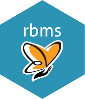

# rbms

With `rbms`, we aim to facilitate the implementation of statistical and
mathematical methods developed for computing relative abundance indices
from yearly time series of butterfly counts. These data are
characterised by temporal patterns (phenology) that must be accounted
for when deriving abundance from a time series of counts. As a toolbox,
we plan to implement more methods to compute and visualise metrics as
they develop. The rbms package will provide the option of being coupled
and working in line with other tools available and developed by the
community (e.g.,
[rtrim](https://cran.r-project.org/web/packages/rtrim/),
[BRCindicators](https://github.com/BiologicalRecordsCentre/BRCindicators)).
With the development of the ‘rbms’ R package, we also provide a tutorial
to facilitate its usage and understanding.

Although `rbms` implements methods that were developed independently and
for which the source should be acknowledged, users should also cite the
`rbms` package and its version to ensure good referencing and improve
the reproducibility of the work.

#### Suggested citation for the rbms package

Schmucki R., Harrower C.A., Dennis E.B. (2026) rbms: Computing
generalised abundance indices for butterfly monitoring count data. R
package version 1.3.1. <doi:10.5281/zenodo.12806606>.
<https://github.com/RetoSchmucki/rbms>

The DOI refers to all versions of rbms and resolves to the latest one.
In R, `citation("rbms")` gives the citation of the package and of the
methods it implements, also as BibTeX.

#### The rbms package implements methods from:

- Dennis, E.B., Freeman, S.N., Brereton, T., Roy, D.B., 2013. Indexing
  butterfly abundance whilst accounting for missing counts and
  variability in seasonal pattern. Methods Ecol Evol 4, 637–645.
  <https://doi.org/10.1111/2041-210X.12053>
- Dennis, E.B., Morgan, B.J.T., Freeman, S.N., Brereton, T.M., Roy,
  D.B., 2016. A generalized abundance index for seasonal invertebrates.
  Biom 72, 1305–1314. <https://doi.org/10.1111/biom.12506>
- Schmucki, R., Pe’er, G., Roy, D.B., Stefanescu, C., Van Swaay, C.A.M.,
  Oliver, T.H., Kuussaari, M., Van Strien, A.J., Ries, L., Settele, J.,
  Musche, M., Carnicer, J., Schweiger, O., Brereton, T.M., Harpke, A.,
  Heliölä, J., Kühn, E., Julliard, R., 2016. A regionally informed
  abundance index for supporting integrative analyses across butterfly
  monitoring schemes. J Appl Ecol 53, 501–510.
  <https://doi.org/10.1111/1365-2664.12561>

#### Installation

Once the [R programming system](https://cran.r-project.org/) is
successfully installed, you can install the `rbms package` from GitHub.
For this you will need to install the package `devtools` or `remotes`,
both available on CRAN. Once installed, use the function
[`devtools::install_github()`](https://devtools.r-lib.org/reference/install-deprecated.html)
to install the `rbms` package on your system.

> Note that `rbms` is built with R \> 4.0, so you might need to update
> your R system before installation. To install devtools on Windows
> system, you will also need to install
> [Rtools](https://cran.r-project.org/bin/windows/Rtools/) - note
> Rtools40 for R 4.x.x New to `R` or want to refresh your R coding
> skills, try the excellent tutorials available at
> [ourcodingclub](https://ourcodingclub.github.io/) 👍

\
`if``(``!`[`requireNamespace`](https://rdrr.io/r/base/ns-load.html)`(``"remotes"``)``)`` `[`install.packages`](https://rdrr.io/r/utils/install.packages.html)`(``"remotes"``)`\
`remotes``::`[`install_github`](https://remotes.r-lib.org/reference/install_github.html)`(``"RetoSchmucki/rbms"``)`

#### Get Started

Consult the [tutorial vignettes /
Articles](https://retoschmucki.github.io/rbms/articles/vignette.html) to
learn about `rbms` data format and the workflow how to compute flight
curves, abundance indices, and collated index with a bootstrap
confidence interval

Further documentation is also available through the help function in R
or from the [rbms online
references](https://retoschmucki.github.io/rbms/reference/index.html)

#### Reporting Issues

For reporting issues related to this package or workflow, please visit
the issue and before opening a new one, see if your problem is not
already in the list reported [issues
here](https://github.com/RetoSchmucki/rbms/issues)
